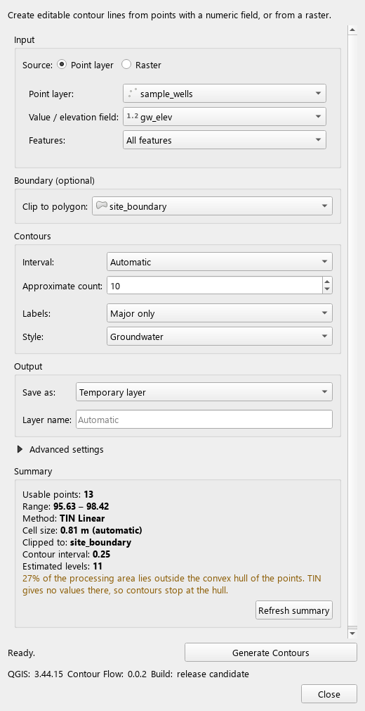
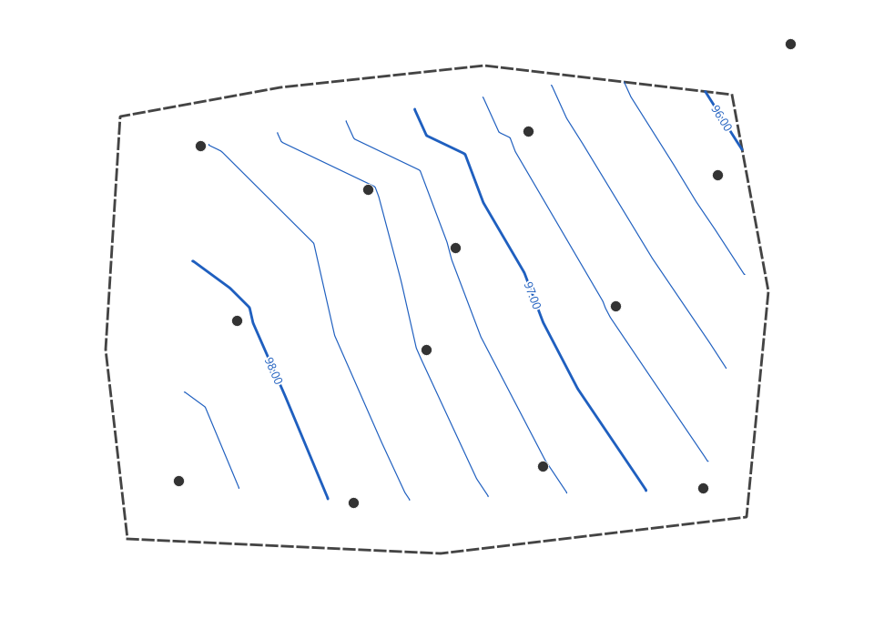

# Contour Flow

Contour Flow is an open-source QGIS plugin for generating editable contour
lines from point elevations and raster surfaces using native QGIS and GDAL
processing tools.

**Point or raster data in → editable contour lines out.** That is all it does.

> **Important interpretation note.** Interpolated contours are estimates
> derived from the supplied data. Results should be reviewed by an
> appropriately qualified user before technical or professional use.

## Features

- **Point-to-contour workflow:** any numeric field of a point layer
  (all features or only the selected ones).
- **Raster/DEM contour workflow:** any band of a file-based raster.
- **Interpolation methods:** TIN Linear, TIN Clough–Tocher and IDW. All are
  QGIS's own algorithms; none of the mathematics is reimplemented.
- **Automatic contour interval:** a clean 1, 2, 2.5 or 5 × 10ⁿ interval for
  an approximate number of contours. Or a **fixed interval**.
- **Clipping:** exact clipping to a polygon boundary, in any CRS.
- **Smoothing:** optional, with presets. The source values are untouched.
- **Major and minor contours:** major contours land on round numbers by
  default.
- **Labels:** off, major only, or all, using native QGIS labelling.
- **Style presets:** Neutral, Topographic, Groundwater. Ordinary QGIS styles
  you can change.
- **Editable vector output:** ordinary QGIS line layers with fields `value`
  and `is_major`.
- **GeoPackage output:** never overwrites existing layers.
- **GeoTIFF surface output:** keep the interpolated surface, optionally.
- **Transparent:** a live summary before you run, and every setting stored in
  the layer metadata.

## Typical uses

Groundwater elevation contours, ground-surface elevation, bedrock elevation,
survey point elevations, DEM contours, and other numeric spatial surfaces
(concentrations, thicknesses and so on). The value field can be anything
numeric; the plugin makes no assumption about what it represents.

## Quick start

1. Install the plugin (see [Installation](#installation)) and add your data to QGIS.
2. Open **Contour Flow** from the toolbar or **Plugins ▸ Contour Flow**.
3. Choose **Point layer** (and its value field) or **Raster**.
4. Optionally choose a boundary polygon to clip to.
5. Keep **Interval: Automatic**, or set a fixed interval. Pick labels and a style.
6. Check the **Summary**, then click **Generate Contours**.

The result is a temporary layer. Save it (right-click ▸ *Make Permanent*), or
choose **Save as: GeoPackage** before running. Technical options (method,
cell size, extent, duplicates, smoothing, major frequency, surface output)
are under **Advanced settings**. Their defaults suit most data.

## Sample data

[`sample_data/`](sample_data/README.md) contains a fictional well dataset
(groundwater, ground-surface and bedrock elevations), a site boundary, a small
DEM, and a ready-made QGIS project, `contour_flow_sample.qgz`. Its README
walks through three five-minute tests.

## Interpolation methods

| Method | How it works | Notes |
|---|---|---|
| **TIN Linear** (default) | Triangulates the points and interpolates linearly within each triangle. | Honest and reproducible. Values never exceed the data range. No values outside the points' convex hull. |
| **TIN Clough–Tocher** | A smoother (cubic) surface on the same triangulation. | Smoother contours. May slightly over- or undershoot the data. |
| **IDW** | Inverse distance weighting: nearby points have more influence (power 2 by default). | Fills the whole extent, so it **extrapolates** beyond the measured points; the plugin warns when that happens. It can produce "bull's-eyes" around points. |

No method adds information that is not in the data. Sparse or clustered
points give uncertain contours whatever the method.

## Installation

**From a release ZIP:**

1. Download `contour-flow-<version>.zip`.
2. In QGIS: **Plugins ▸ Manage and Install Plugins ▸ Install from ZIP**, then
   choose the file and click *Install Plugin*.
3. The plugin is marked *experimental*. If it is not listed, enable
   *Settings ▸ Show also experimental plugins* in the Plugin Manager.

**For development:** link the repository's `contour_flow/` folder into your
QGIS profile. See [DEVELOPMENT.md](DEVELOPMENT.md).

**Requirements:** QGIS **3.44 LTR**. The core **Processing** plugin must be
enabled (it is by default). There are no other dependencies.

## Testing

| Level | What | Command |
|---|---|---|
| Unit tests | Pure-Python logic (intervals, validation, options, metadata) | `python -m unittest discover -s tests -t .` |
| Real-QGIS integration tests | The real plugin running real QGIS/GDAL processing on fixtures with known answers, plus the sample data, the dialog and plugin loading | `tests\integration\run_qgis_integration_tests.bat` |
| Package test | Builds the release ZIP, validates it, installs it into an isolated QGIS profile and runs it | `scripts\run_with_qgis.bat scripts\package_plugin.py` |
| Visual smoke test | A short manual checklist | [TESTING.md](TESTING.md) |

Tested on **QGIS 3.44.15 LTR** (GDAL 3.13.3, Windows 11). QGIS 4 is not tested,
and no QGIS 4 compatibility is claimed.

## Current limitations

- Processing runs in the QGIS main thread. A progress dialog with **Cancel**
  is shown, but other QGIS work waits until the run finishes.
- Contour levels are multiples of the interval (no base offset).
- Only exact duplicate coordinates are detected, not points that are merely
  close together.
- Only file-based (GDAL) rasters can be contoured.

## Contributing and issues

Please report problems at
<https://github.com/Holmes-090/Contour_Flow/issues>. Include the QGIS
version and the plugin's log: **View ▸ Panels ▸ Log Messages ▸ Contour Flow**.

Architecture and development notes: [ARCHITECTURE.md](ARCHITECTURE.md),
[DEVELOPMENT.md](DEVELOPMENT.md), [CHANGELOG.md](CHANGELOG.md).

## License

Contour Flow is free software, licensed under the **GNU General Public
License, version 2 or (at your option) any later version**
(`GPL-2.0-or-later`). See [LICENSE](LICENSE). This matches QGIS's own license.
