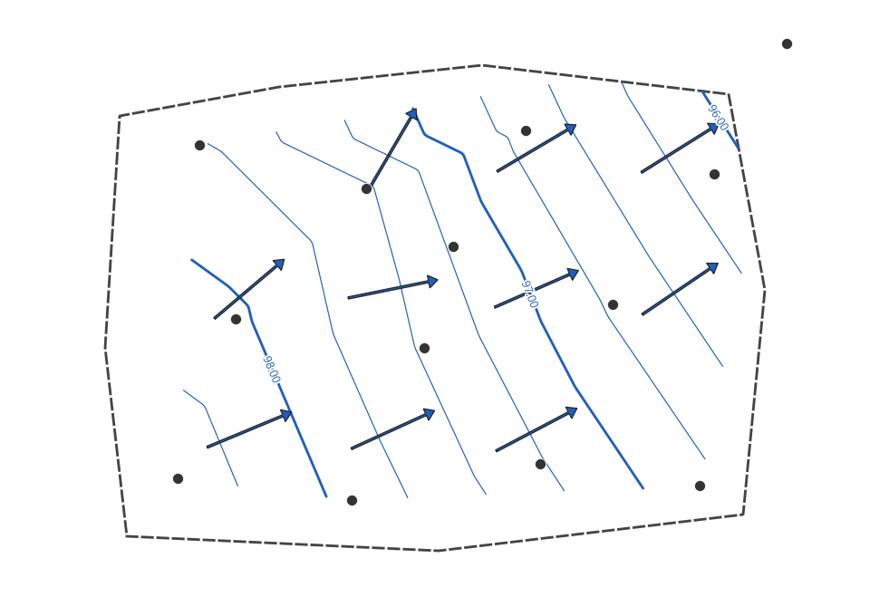
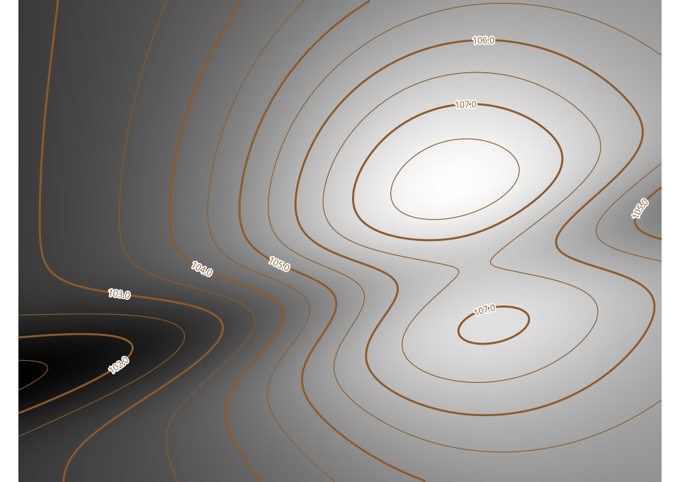

# Contour Flow

**Make editable contour lines in QGIS from point measurements or an elevation
raster, in a few clicks.**

Contour Flow is a free, open-source QGIS plugin. Choose a point layer with a
number field (such as groundwater levels or survey elevations) or a DEM, and
it draws clean, labelled contour lines that you can edit and save like any
other layer.

## What you can do with it

- **Contour point data:** turn well, borehole or survey points into contours of
  groundwater level, ground surface, bedrock, or any other measured value.
- **Contour a DEM:** draw contour lines from an elevation raster.
- **Clip to your site:** keep only the contours inside a boundary polygon.
- **Get readable maps straight away:** major and minor contours, labels, and a
  choice of styles (Neutral, Topographic, Groundwater).
- **Edit and keep the results:** the output is a normal QGIS line layer. Move
  lines, change the style, or save it to a GeoPackage.
- **Groundwater Mode:** turn monitoring wells into groundwater-elevation
  contours, with groundwater data checks and optional flow-direction arrows
  (see below).

It uses QGIS's own interpolation and contouring tools, so there is nothing
extra to install.

## Getting started

1. In QGIS, open **Plugins ▸ Manage and Install Plugins**, search for
   **Contour Flow**, and click **Install**.
   (While the plugin is marked *experimental*, tick *Show also experimental
   plugins* in the Plugin Manager's **Settings** tab first.)
2. Add your point layer or DEM to the map.
3. Click the **Contour Flow** toolbar button, or use **Plugins ▸ Contour Flow**.
4. Choose your layer (and, for points, the value field). Optionally pick a
   boundary to clip to.
5. Click **Generate Contours**.

That's it. The new contour layer appears in your project. It is a temporary
layer, so to keep it, right-click it and choose **Make Permanent**, or set
**Save as: GeoPackage** before you generate.

## Tips

- **Interval:** *Automatic* picks a tidy contour spacing for you. Switch to
  *Fixed* to set your own, for example every 0.5 m.
- **Summary:** the Summary box shows what will happen (number of points,
  value range, contour interval) before you click Generate.
- **Advanced settings:** open this section to choose the interpolation method,
  the cell size, smoothing and more. The defaults work well for most data.
- **Selected features only:** contour just the points you have selected on the map.
- **Your settings travel with the result:** every contour layer records how it
  was made, in **Layer Properties ▸ Metadata**.

## Groundwater Mode

Choose **Mode: Groundwater** at the top of the window for a workflow made for
monitoring-well data: wells, groundwater elevations, checks, contours and
flow direction.

- **Groundwater elevations, your way:** use a field that already holds them
  (any name), or let Contour Flow calculate them as *measuring-point
  elevation − depth to water*. Your layer is never changed.
- **Spreadsheet-style text values work:** a text field such as `WL` holding
  `"202.51"` is offered as *"WL — text field, numeric values detected"*.
  Entries like `Dry` or `N/A` and blanks are skipped and reported, never
  treated as 0. The window shows, for example, *13 usable groundwater
  elevations / 4 skipped*.
- **Groundwater checks before you rely on the map.** Warnings marked
  *IMPORTANT* cover:
  - wells at the same location with different values (often nested wells,
    different screens or aquifers);
  - groundwater above ground (with an optional ground-elevation field; this
    can be real artesian conditions);
  - wells far off the site-wide trend;
  - areas where values are extrapolated beyond the wells.

  Problem wells are kept, not removed.
- **Readable, honest contours:** blue Groundwater styling, and *Light*
  smoothing by default. The smoothing is checked, so it never makes contours
  cross, and the result records how far lines moved. Smoothing makes contours
  easier to read but not more accurate.
- **Flow arrows (optional):** tick **Generate flow arrows** to add a
  **GW Flow Direction** layer. The arrows represent interpreted
  hydraulic-gradient direction derived from the interpolated groundwater
  surface. They point from higher to lower groundwater elevation, are drawn
  only where wells support the surface (the well network by default), and are
  kept few so the map stays readable. When the directions agree, the result
  also gives a *general groundwater flow direction* (for example "northeast /
  approximately 60°"). This is a generalized interpretation, not measured flow.
- **Everything is recorded:** the layers' metadata lists the wells used and
  skipped, the method, smoothing, arrow settings and all warnings.

Output layers are named **GW Contours**, **GW Flow Direction**, and,
optionally, **GW Contours - Unsmoothed** and **GW Surface**. Arrow count,
length, scaling and the area they cover are under **Advanced settings ▸
Groundwater**.

Groundwater Mode does not calculate flow velocity, flux, travel times or
contaminant transport.

## Try it with the sample data

The [`sample_data`](sample_data/README.md) folder has a small, fictional
example: 13 wells, a site boundary and a DEM. Open
`contour_flow_sample.qgs` in QGIS and follow the short tests in its README.

### Groundwater Mode demo

1. Open `sample_data/contour_flow_sample.qgs` and start Contour Flow.
2. Set **Mode** to **Groundwater**, **Point layer** to `sample_wells`, and
   **Clip to polygon** to `site_boundary`.
3. Keep **Groundwater elevation: Existing field** with `gw_elev`, and tick
   **Generate flow arrows**.
4. Click **Generate Contours**. You get blue GW Contours and about ten arrows
   pointing north-east. The message gives the general flow direction:
   north-east, about 60°.
5. Now switch **Groundwater elevation** to **Calculate: MP − depth to water**
   (`mp_elev`, `dtw`). The summary reports 1 skipped well (MW-10 has no
   depth to water) and an **IMPORTANT** warning for MW-12. Its depth to water
   was deliberately entered 1.8 m too deep, and the check catches it.
6. Try the text field `wl_text`: 11 usable values, with `Dry` and `N/A`
   reported and skipped.

## A note on accuracy

Contours drawn from points are **estimates**. Between and beyond your
measurements, the plugin can only interpolate what the data suggests. Results
should be reviewed by an appropriately qualified person before being used for
technical or professional decisions.

## Requirements

- QGIS 3.44 (LTR) or newer 3.x
- The **Processing** plugin enabled (it is on by default)
- Tested on Windows. It uses only tools built into QGIS, so it should also run
  on macOS and Linux. Please report any problems there.

## Help and feedback

Found a problem or have a suggestion? Please open an issue at
<https://github.com/Holmes-090/Contour_Flow/issues>. It helps to include your
QGIS version, and any messages from **View ▸ Panels ▸ Log Messages ▸ Contour Flow**.

## For developers

How the plugin is built and tested: [ARCHITECTURE.md](ARCHITECTURE.md),
[DEVELOPMENT.md](DEVELOPMENT.md), [TESTING.md](TESTING.md),
[CHANGELOG.md](CHANGELOG.md).

## License

Contour Flow is free software under the GNU General Public License v2 or later
(GPL-2.0-or-later). See [LICENSE](LICENSE).
